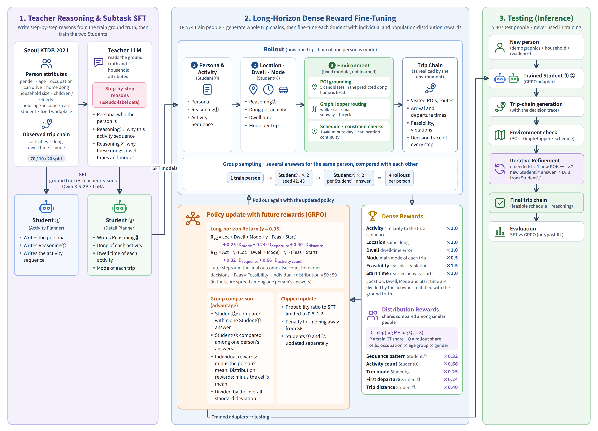

# PersonaTC

Persona-conditioned generation of one-day trip chains for Seoul residents, learned
from the KTDB 2021 household travel survey.

Two small language models (Qwen3.5-2B with LoRA adapters) write a person's day from
their demographics, and a fixed environment turns it into a routed, scheduled day:

- **Student1** writes a persona, its reasoning and the **activity sequence**.
- **Student2** writes its reasoning, the **location** (administrative dong) and
  **dwell time** of every activity, and the **main mode** of every trip.
- The **environment** picks POIs, routes every trip with GraphHopper, schedules the
  day and checks feasibility. It is not learned.

The Students are trained by supervised fine-tuning (SFT) on Teacher-written personas
and reasoning, then fine-tuned with rewards from the environment (GRPO). At test time
an infeasible day goes through a bounded refinement loop.



The figure shows the current model. Its source is in `docs/figures/src/`.

## How it works

**Students.** Prompts and answers are JSON. Each answer gives the reasons before the
decisions.

| | Reads | Writes |
|---|---|---|
| Student1 | demographics (gender, age, occupation, can_drive, residence; household size and composition, housing, income, cars, school level and workplace status when the survey has them) | `persona_bundle`, `reasoning1`, `activity_sequence` |
| Student2 | demographics and the Student1 answer | `reasoning2`, `location_dwell_by_activity`, `trip_modes` |

An invalid answer is generated again from the same prompt. There is no constrained
decoding. Attributes the survey left blank are left out of the prompt, not filled in.

**Teacher.** A larger model (Qwen2.5-32B) reads each train person's attributes and
observed day and writes the persona and reasoning the Students learn to write. A
label that contradicts the household size is generated again.

**Environment.** Each activity gets candidate POIs inside the dong Student2 named.
GraphHopper routes every trip in the mode Student2 named (walk, car, bus, subway;
bicycle time is walk time divided by 3). The day runs 1,440 minutes from 03:00, and
the last stay lasts until the day ends. A day is feasible when it starts at home,
every trip is routable, a car or bicycle is where the traveler left it, and it ends
within the day. Days with an activity outside Seoul are set aside as
`outside_poi_coverage`.

**Rewards.** Individual rewards compare a generated day with that person's own
ground truth: activity sequence, location, dwell, trip mode, feasibility and start
time. Location, dwell, trip mode and start time are scored on the activities matched
with the ground truth. Distribution rewards compare the generated population with the
train ground truth among similar people (occupation, age group, gender): the sequence
pattern and the number of activities for Student1; trip mode, first departure and
trip distance for Student2. The two kinds have equal weight (50:50). The weights are
in `configs/framework_grpo_train_v2ctxt_s1count.yaml` (Student1) and
`configs/framework_grpo_train_v2ctxt_s2w.yaml` (Student2), with the reason for each
value written next to it.

**GRPO.** Every train person gets two Student1 answers, and each of those gets two
Student2 answers. Individual rewards are compared among one person's answers and
distribution rewards among the answers of one demographic cell. Each Student is
updated with a clipped policy-gradient step that stays close to its starting adapter.

**Result.** Validation split, 2,653 people, one generated day each
(`results/v2/v2ctxt_s1count_s2cell/`):

| | Ground truth | Model |
|---|---|---|
| Days that are home-work-home | 23.0% | 23.1% |
| Days with five or more activities | 23.4% | 21.9% |
| Activity sequence equal to the person's own | | 20.9% |
| Same dong, on matched activities | | 74.4% |
| Trip mode, on matched activities | | 35.9% |
| Feasible days | | 89.4% |
| Feasible days, among days inside Seoul | | 99.7% |

## Repository layout

| Path | Contents |
|---|---|
| `tripchain/` | The package: Student inference (`inference.py`, `parallel_inference.py`, `policy_runtime.py`), environment (`environment.py`, `poi.py`, `graphhopper.py`, `scheduling.py`, `optimizer.py`), rewards (`rewards.py`, `distribution_reward.py`, `trip_distance.py`, `trip_modes.py`), rollout and refinement (`rollout.py`, `refinement.py`), metrics (`population_metrics.py`), paths and config loading (`paths.py`, `common.py`, `residence.py`) |
| `tripchain/ktdb/` | Teacher inputs, prompt and answer validation (`ktdb_two_stage_teacher.py`); builders of the SFT examples (`ktdb_student1.py`, `ktdb_student2.py`, `ktdb_student_common.py`) |
| `scripts/` data | `prepare_ktdb_training_data.py` (with `ktdb_admin_registry.py`, `korean_admin_english.py`), `prepare_residence_data.py`, `build_train_ground_truth.py`, `build_trip_mode_data.py`, `rebuild_ground_truth_v2.py`, `build_teacher_relabel_inputs.py`, `build_sft_v2.py` |
| `scripts/` Teacher and SFT | `run_teacher_2gpu.py` (starts `teacher_worker.py` on each GPU), `train_student1.py`, `train_student2_tripmode.py` |
| `scripts/` generation | `run_student_inference.py`, `run_student_inference_2gpu.py`, `repair_student2_failures.py`, `start_graphhopper.sh`, `run_rollouts.py`, `run_rollouts_parallel.py`, `refine_infeasible.py` |
| `scripts/` GRPO | `measure_distribution_weights.py`, `prepare_policy_updates.py`, `train_group_relative.py` |
| `scripts/` evaluation | `evaluate_population.py`, `compare_rollouts.py`, `bootstrap_pair.py`, `visualize_population.py` |
| `scripts/run_v2*.sh` | Pipelines that chain the scripts above (see [Current model](#current-model)) |
| `scripts/` context | `build_context_v2.py`, `teacher_ctx.py`, `teacher_ctx_python`, `build_sft_v2ctxt.py` |
| `configs/` | `student*_sft.yaml` (SFT), `framework_grpo_train_*.yaml` (train rollouts and rewards), `framework_*_validation.yaml` and `framework_v2_test.yaml` (evaluation), `poi_category_map.yaml` (which POIs can host each activity) |
| `prompts/`, `templates/` | The Teacher prompt; the chat template that limits the SFT loss to the answer |
| `tests/` | Unit tests of the environment, rewards, GRPO grouping and answer validation |

Every script starts with a docstring that says what it does, and `--help` lists its
options.

## Setup

```bash
git clone git@github.com:ashleycwyoon/persona_tripchain.git personaTC && cd personaTC
pip install -e ".[train,dev]"        # add the "teacher" extra where the Teacher runs
python -m pytest -q                  # no GPU or data needed
```

- Python 3.10 or newer. The reference runs used torch 2.5.1, transformers 5.13.0,
  peft 0.19.1, trl 1.7.1 and vllm 0.7.3.
- Two GPUs (the pipelines place jobs on GPU 0 and GPU 1; the reference machine had
  two 48 GB GPUs) and 16 CPU workers for the rollouts.
- A GraphHopper 11.0 server with a public-transit graph of Korea.

The repository holds code only. Three environment variables say where the rest lives:

| Variable | Default | Holds |
|---|---|---|
| `DATA_HOME` | `~/data` | raw survey data and derived datasets |
| `OUTPUT_HOME` | `~/outputs` | Teacher labels, adapters, rollouts, analyses |
| `HF_HUB_CACHE` | the Hugging Face default | downloaded model weights |

You must supply these inputs under `$DATA_HOME`:

- `KTDB_2021/①개인특성.csv` and `②이동특성.csv`, the KTDB 2021 microdata.
- `행정동코드_20210726(말소코드포함).xlsx`, the administrative-code workbook.
- `tripchain_1015/processed/testing/seoul_poi_catalog_by_admin_dong.parquet`, one
  row per Seoul POI with `poi_id`, `longitude`, `latitude`,
  `administrative_dong_code`, a name, and the OSM tag columns (`amenity`, `shop`,
  `office`, `leisure`, `tourism`, `healthcare`, `building`).
- `tripchain_1030/external/GraphHopper/` with `graphhopper-web-11.0.jar`, a JDK 17
  in `.jdk17/`, `gtfs.zip` and `config-pt-rebuilt.yml`.

Datasets are written to `$DATA_HOME/tripchain_1015` and `$DATA_HOME/tripchain_1030`,
and results to the same two folder names under `$OUTPUT_HOME`. The names are the
historical project names.

## Tutorial

Run every command from the repository root. Long steps can be interrupted: running
the same command again continues where it stopped.

```bash
V2_DATA=$DATA_HOME/tripchain_1030/processed_v2
V2=$OUTPUT_HOME/tripchain_1030/v2
```

### 1. Data and Teacher labels

```bash
python scripts/prepare_ktdb_training_data.py     # Seoul residents, demographics, observed days
python scripts/run_teacher_2gpu.py --gpus 0,1    # Teacher personas and reasoning (Qwen2.5-32B, vLLM)
python scripts/prepare_residence_data.py         # add the home location
python scripts/build_train_ground_truth.py
python scripts/build_trip_mode_data.py           # main mode of every trip
python scripts/rebuild_ground_truth_v2.py        # v2 ground truth, split 70 / 10 / 20

python scripts/build_teacher_relabel_inputs.py   # people whose day changed in v2
python scripts/run_teacher_2gpu.py --gpus 0,1 \
  --demographics $V2_DATA/teacher_relabel/demographics.jsonl \
  --activity $V2_DATA/teacher_relabel/activity_sequence.jsonl \
  --spatial $V2_DATA/teacher_relabel/location_dwell_mode_preference.jsonl \
  --output-prefix $OUTPUT_HOME/tripchain_1030/teacher_relabel_v2/teacher_v2

python scripts/build_sft_v2.py                   # SFT examples for both Students
```

The split is 18,574 train, 2,653 validation and 5,307 test people. Keep
`--gpus 0,1` for the Teacher, because later steps expect its two output shards.

### 2. SFT

```bash
python scripts/train_student1.py --config configs/student1_v2_sft.yaml --gpu 0
python scripts/train_student2_tripmode.py --config configs/student2_v2_sft.yaml --gpu 1
```

The two trainings can run at the same time. `--dry-run` checks the data without
training. The adapters are saved in `$OUTPUT_HOME/tripchain_1030/runs/`.

### 3. Rollouts, GRPO and evaluation

```bash
bash scripts/start_graphhopper.sh &              # keep it running; `curl localhost:8989/health` prints OK
mkdir -p $V2
bash scripts/run_v2_rollouts.sh                  # train rollouts for GRPO, pre-RL validation and test
python scripts/measure_distribution_weights.py $V2/grpo_train/s1_seed*/s2_sample*/rollouts.jsonl \
  --config configs/framework_grpo_train_v2.yaml  # prints the distribution weights
bash scripts/run_v2_grpo.sh                      # GRPO, post-RL generation, refinement, evaluation
```

Copy the measured weights into `rewards.distribution` of
`configs/framework_grpo_train_v2.yaml`; the values in the repository (0.82, 1.04,
0.43) come from the reference run. The pipelines write one log per step to
`$V2/logs/`. Results:

- `$V2/grpo/student{1,2}/final`: the GRPO adapters
- `$V2/pre_rl_*/` and `$V2/post_rl_*/`: Student answers and `rollouts.jsonl`
- `$V2/analysis/`: `metrics.json` per population, comparisons and figures

To try the chain on two people first, run `scripts/run_student_inference.py`
(`student1`, then `student2`) with `--limit 2`, then `scripts/run_rollouts.py` and
`scripts/evaluate_population.py` on the result.

## Current model

The tutorial above trains the base model, whose Students read five attributes. The
current model adds the household, school and work attributes and the rewards described
in [How it works](#how-it-works). Its pipelines compare against earlier runs, so run
these first, in this order: `run_v2_noendhome_baselines.sh 0`, `run_v2_seqboost.sh`,
`run_v2_s1_multiseed.sh`.

| Command | What it does | Output |
|---|---|---|
| `python scripts/build_context_v2.py` | Adds the household, school and work attributes to the Student inputs | `processed_v2ctx/` |
| `RUN_GRPO=1 bash scripts/run_v2ctxt.sh` | Teacher labels with those attributes, SFT of both Students, train rollouts and a first GRPO | `v2ctxt/` |
| `bash scripts/run_v2ctxt_s1cell.sh` | Student1 GRPO with sequence weight 1.64, the comparison run of the next step | `v2ctxt_s1cell/` |
| `NAME=v2ctxt_s1count TRAIN_CFG=configs/framework_grpo_train_v2ctxt_s1count.yaml bash scripts/run_v2ctxt_s1cell.sh` | Student1 GRPO with the current rewards | `v2ctxt_s1count/` |
| `bash scripts/run_v2ctxt_s2cell.sh` | Student2 GRPO with the current rewards | `v2ctxt_s2cell/` |
| `NAME=v2ctxt_s1count_s2cell S1_RUN=v2ctxt_s1count bash scripts/run_v2ctxt_s2cell.sh` | Evaluates the two Students together | `v2ctxt_s1count_s2cell/` |

Each pipeline writes to its own folder under `$V2`, evaluates on the validation split
and ends with paired bootstrap comparisons and distribution figures. Without
`RUN_GRPO=1`, `run_v2ctxt.sh` stops after SFT so that result can be checked first.
The other `scripts/run_v2*.sh` files are earlier experiments; the header of each says
what it does.

## Included data and results

| Path | Contents |
|---|---|
| `data/processed_v2/` | The v2 dataset: ground truth and demographics of the train, validation and test people, the split, the Teacher inputs and labels (`sft_build/`, `teacher_relabel/`) and the SFT examples (`sft/`) |
| `results/v2/<run>/analysis/` | `metrics.json`, paired bootstraps, comparison tables and figures of every run |
| `results/v2/<run>/*_validation/` | Validation answers of both Students and the final rollouts, gzipped (`student1.jsonl.gz`, `student2.jsonl.gz`, `rollouts.jsonl.gz`) |

`<run>` is the folder name under `$V2`. `v2ctxt_s1count_s2cell` is the current model;
the other folders are the runs it is compared with and earlier experiments. The runs
before `v2ctxt_s1cell` were trained with an earlier form of the distribution rewards,
so rerunning their pipelines with the current code gives different numbers.
Adapters, train rollouts and the test-split rollouts are not included.

To skip tutorial step 1, copy the dataset to where the code reads it:

```bash
mkdir -p $DATA_HOME/tripchain_1030 && cp -r data/processed_v2 $DATA_HOME/tripchain_1030/
```

Rollouts and evaluation still need the location codebook, the POI catalog and
GraphHopper (see Setup). `data/processed_v2` is person-level data derived from the
KTDB 2021 survey: keep it inside the project and follow the KTDB terms of use.

## Reading the results

`metrics.json` from `scripts/evaluate_population.py`:

| Key | Meaning |
|---|---|
| `activity_sequence_exact_accuracy`, `activity_sequence_lcs_f1_mean` | activity sequence, per person |
| `location_dong_exact_on_lcs`, `dwell_within_30_min`, `trip_mode_accuracy_on_lcs` | decisions on matched activities, per person |
| `feasible_rate`, `status_counts` | feasibility in the environment |
| `distribution.population`, `distribution.subgroup_mean` | Jensen-Shannon divergence from the ground truth; lower is better |

A rollout row has `status` `ok`, `infeasible`, `outside_poi_coverage` or `failed`
(the routing server did not answer; such rows are retried with `--resume`).
`scripts/bootstrap_pair.py` gives a 95% interval for the difference between two
populations, and `scripts/visualize_population.py` draws the distributions.

## Development

```bash
python -m pytest -q
ruff check . && ruff format --check .
```

The KTDB preprocessing, the Teacher and the SFT trainers come from the earlier
`tripchain_1015` project (commit `637b7b0`); only their imports and paths were adapted.
