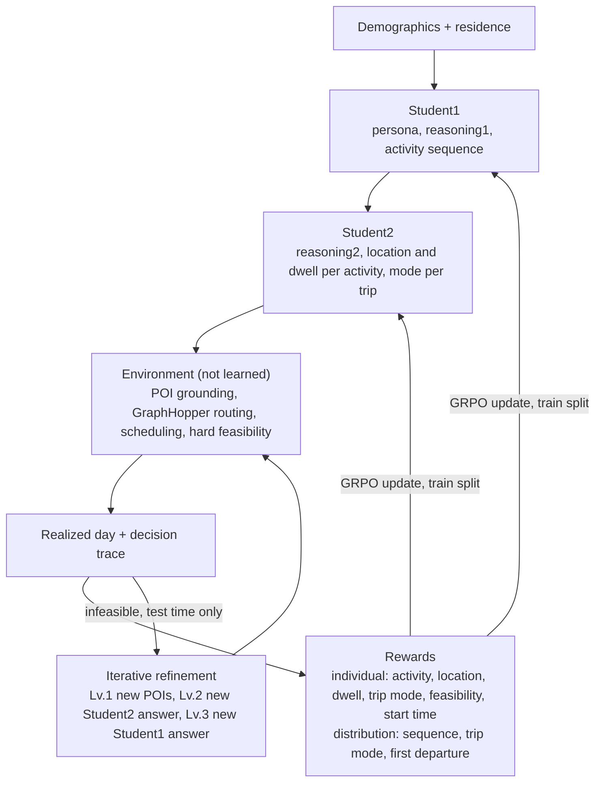

# PersonaTC

Persona-conditioned generation of one-day trip chains for Seoul residents, learned
from the KTDB 2021 household travel survey.

Two small language models (Qwen3.5-2B with LoRA adapters) generate a person's day
from their demographics, and a non-learning environment turns it into a routed,
scheduled day on the real network:

- **Student1** writes a persona, its reasoning and the **activity sequence**.
- **Student2** writes its reasoning, the **location** (administrative dong) and
  **dwell time** of every activity, and the **main mode** of every trip.
- The **environment** picks POIs, routes every trip with GraphHopper (walk, bicycle,
  bus, subway, car), schedules the day and checks hard feasibility.

The Students are first trained by supervised fine-tuning (SFT) on Teacher-written
personas and reasoning, then fine-tuned with dense rewards from the environment
(GRPO). At test time an infeasible day goes through a bounded refinement loop.

## Contents

1. [How the framework works](#1-how-the-framework-works)
2. [Repository layout](#2-repository-layout)
3. [Requirements](#3-requirements)
4. [Data and output locations](#4-data-and-output-locations)
5. [Tutorial: running the full framework](#5-tutorial-running-the-full-framework)
6. [Reading the results](#6-reading-the-results)
7. [Configuration reference](#7-configuration-reference)
8. [Development](#8-development)

## 1. How the framework works



| Stage | What happens | Where |
|---|---|---|
| Ground truth | KTDB trips become one day per person (03:00 to 03:00), split train / validation / test = 70 / 10 / 20 | `scripts/rebuild_ground_truth_v2.py` |
| Teacher | A large LLM writes the persona and the reasoning that explain each observed day | `third_party/tripchain_1015` |
| SFT | Each Student learns to write the Teacher text and the observed decisions | `scripts/train_student1.py`, `scripts/train_student2_tripmode.py` |
| Rollout | Student1, Student2, then the environment, for every person | `scripts/run_student_inference_2gpu.py`, `scripts/run_rollouts_parallel.py` |
| GRPO | Group-relative policy update from the rollout rewards | `scripts/prepare_policy_updates.py`, `scripts/train_group_relative.py` |
| Testing | Generation, refinement of infeasible days, evaluation against the ground truth | `scripts/refine_infeasible.py`, `scripts/evaluate_population.py` |

### Student prompts and answers

Both prompts are compact JSON user messages; both answers are JSON objects whose keys
are written in the order below (reasons before the decisions they explain).

| | Prompt (user message) | Answer |
|---|---|---|
| Student1 | `{"demographics": {gender, age, occupation, can_drive, residence: {sido, sigungu, administrative_dong_name}}}` | `persona_bundle`, `reasoning1`, `activity_sequence` |
| Student2 | `demographics`, `activity_sequence`, `persona_bundle`, `reasoning1` | `reasoning2`, `location_dwell_by_activity`, `trip_modes` |

- Activity types: `home`, `work`, `school`, `shopping`, `eat_out`, `leisure`, `escort_care`, `medical`, `other`.
- A location is `{"scope": "seoul", "administrative_dong_name", "gu"}` or
  `{"scope": "external", "sido", "sigungu"}`. Student2 receives no list of
  locations; its answer is validated against the KTDB location codebook after
  generation.
- `trip_modes[i]` is the main mode of the trip from activity `i` to activity `i+1`.
- There is no constrained decoding. An invalid answer is regenerated from the same
  prompt; people whose Student2 answer never validates get a new Student1 answer
  (`scripts/repair_student2_failures.py`). Every accepted answer is stored with the
  exact prompt that produced it, and GRPO trains on those stored prompts.

### Environment

- **POI grounding.** Each activity gets a seeded pool of activity-compatible POIs
  inside the dong Student2 named. All home activities share one synthetic home anchor.
- **Routing.** GraphHopper supplies walk, car, bus and subway routes; bus and subway
  use the GTFS timetable at the actual departure time. Bicycle time is synthetic:
  walk time divided by 3.
- **Mode.** A trip is routed in the mode Student2 named. If that mode cannot be
  realized (no route, or the car or bicycle is not at the origin) the trip falls back
  to another mode and counts as a mode violation.
- **Schedule.** An activity starts on arrival and lasts its predicted dwell. The day
  runs 1,440 minutes from 03:00; the last home stay is the rest of the day.
- **Hard feasibility.** Every trip is routable, a private car or bicycle is where the
  traveler left it, and the day ends within 1,440 minutes. A day with an activity
  outside Seoul cannot be grounded and is set aside as `outside_poi_coverage`.

### Rewards and GRPO

Individual rewards compare a generated day with that person's own ground truth
(`tripchain/rewards.py`). Location, dwell, trip mode and start time are scored on
activities matched by the longest common subsequence of the two activity sequences.

| Component | Meaning | Weight |
|---|---|---|
| activity | LCS F1 of the activity sequences | 1.0 |
| location | same dong 1, same gu 0.5 (outside Seoul: same sigungu 1, same sido 0.5) | 1.0 |
| dwell | `exp(-error / 120 min)` | 1.0 |
| trip_mode | share of trips with the right main mode | 0.5 |
| feasibility | bonus for a feasible day minus violation penalties | 1.5 |
| start_time | `exp(-error / 60 min)` of the realized activity starts | 1.0 |

Each Student receives a discounted return (discount 0.95): Student2 its own location,
dwell and mode rewards plus the discounted realized outcome (feasibility, start
time); Student1 the activity reward plus Student2's rewards one step discounted and
the realized outcome two steps discounted.

Distribution rewards (`tripchain/distribution_reward.py`) keep the generated
population from collapsing onto the most common days. Within a cell of similar
people (occupation, age bucket, gender), `clip(log P - log Q, ±3)` compares the share
`Q` the policy generates with the share `P` in the train ground truth. Student1
receives it for its activity sequence, Student2 for its trip modes and its first
departure hour. Trip-mode cells can also carry the trip's distance band
(`trip_mode_cells: distance`).

GRPO groups are two-level: every train person has two Student1 answers, and each of
them has two Student2 answers. Student2 advantages compare answers to one identical
prompt; Student1 advantages compare a person's Student1 answers by their mean
return. The update is a clipped, reference-regularized policy-gradient step
(`scripts/train_group_relative.py`).

## 2. Repository layout

```
personaTC/
├── configs/        run and training configurations
├── scripts/        command-line entry points and pipeline scripts
├── tripchain/      the Python package (environment, rewards, inference)
├── tests/          unit tests
└── third_party/    upstream code this framework builds on, vendored unmodified
```

### `tripchain/` — package

| File | Role |
|---|---|
| `__init__.py` | Exposes `TripChainEnvironment` and `score_rollout` |
| `paths.py` | Where data, outputs and model weights live; expands `${...}` variables in configs |
| `common.py` | Config loading, JSONL helpers, the Students' JSON key orders |
| `residence.py` | Adds and validates the residence in the Student demographics |
| `inference.py` | Student1 / Student2 prompts, generation and answer validation on one GPU |
| `parallel_inference.py` | Runs inference as one shard per GPU and merges the results |
| `policy_runtime.py` | Both Students in one process, used by the refinement loop |
| `poi.py` | POI grounding: candidate POIs per activity inside the predicted dong |
| `graphhopper.py` | GraphHopper client (walk, car, bus, subway; synthetic bicycle) with caching |
| `scheduling.py` | Places an activity on arrival without stretching its dwell |
| `optimizer.py` | Joint POI and mode selection over hard-feasible chains |
| `environment.py` | The environment: grounding, routing, scheduling, violation counts |
| `rewards.py` | Individual reward components and each Student's discounted return |
| `distribution_reward.py` | Population-level rewards on smoothed demographic cells |
| `trip_distance.py` | Distance band of a trip, for distance-conditioned trip-mode cells |
| `trip_modes.py` | Main mode of a KTDB trip, and the person-level mode ranking derived from trips |
| `rollout.py` | One rollout row: decision trace, environment result, rewards, status |
| `refinement.py` | Bounded refinement of an infeasible day (Lv.1, Lv.2, Lv.3) |
| `population_metrics.py` | Jensen-Shannon divergences for the population and persona subgroups |

### `scripts/` — data preparation

| File | Role |
|---|---|
| `prepare_residence_data.py` | Adds the surveyed home location to the v1 train / test demographics |
| `build_train_ground_truth.py` | Joins the v1 train targets into one ground-truth file |
| `build_trip_mode_data.py` | Adds the main mode of every trip to the v1 ground truth |
| `rebuild_ground_truth_v2.py` | Builds the v2 ground truth (clipped day, merged short round trips) and the 70 / 10 / 20 split |
| `build_teacher_relabel_inputs.py` | Teacher inputs for the people whose day changed from v1 to v2 |
| `build_sft_v2.py` | Student1 and Student2 SFT datasets on the v2 train and validation splits |

### `scripts/` — training, inference, environment, evaluation

| File | Role |
|---|---|
| `train_student1.py` | Student1 SFT (wraps the upstream QLoRA trainer) |
| `train_student2_tripmode.py` | Student2 SFT with per-trip modes (wraps the upstream QLoRA trainer) |
| `run_student_inference.py` | Student1 or Student2 inference on one GPU |
| `run_student_inference_2gpu.py` | The same on several GPUs, one shard per GPU |
| `repair_student2_failures.py` | New Student1 then Student2 answers for people without a valid Student2 answer |
| `start_graphhopper.sh` | Starts the GraphHopper server the environment queries |
| `run_rollouts.py` | Environment rollouts and rewards, single process |
| `run_rollouts_parallel.py` | The same with several worker processes |
| `refine_infeasible.py` | Refinement of infeasible rollouts (inference only) |
| `measure_distribution_weights.py` | Distribution reward weights that balance individual and distribution rewards |
| `prepare_policy_updates.py` | Turns rollout groups into GRPO training records with advantages |
| `train_group_relative.py` | The GRPO update of one Student adapter |
| `evaluate_population.py` | Metrics of one generated population against the ground truth |
| `compare_rollouts.py` | Per-person comparison of two rollout files |
| `bootstrap_pair.py` | Paired bootstrap confidence intervals between two populations |
| `visualize_population.py` | Distribution figures of the ground truth and two to four populations |

### `scripts/` — pipelines

| File | Role |
|---|---|
| `run_v2_rollouts.sh` | Step 1: rollouts of the SFT Students on train (GRPO groups), validation and test |
| `run_v2_grpo.sh` | Step 2: GRPO round 1, post-RL generation, refinement, evaluation and figures |
| `run_v2_round2.sh` | Optional: a second GRPO round starting from the round-1 adapters |
| `run_v2_distmode.sh` | Optional: round 1 with the distance-conditioned trip-mode reward |
| `run_v2_distmode_weight.sh` | Optional: sweep of the trip-mode distribution weight |

### `configs/`

| File | Role |
|---|---|
| `student1_v2_sft.yaml`, `student2_v2_sft.yaml` | SFT settings of the two Students |
| `framework_grpo_train_v2.yaml` | Train split: inference, environment and reward settings for GRPO rollouts |
| `framework_grpo_train_v2_distmode.yaml` | The same with distance-conditioned trip-mode cells |
| `framework_v2_validation.yaml`, `framework_v2_test.yaml` | Evaluation on the validation and test splits |
| `poi_category_map.yaml` | Which OSM tags and official building uses can host each activity type |

### Other files

| File | Role |
|---|---|
| `tests/test_framework.py` | Unit tests of the environment, rewards, GRPO grouping and answer validation (no GPU, data or routing server needed) |
| `pyproject.toml` | Dependencies and the pytest and ruff settings |

### `third_party/tripchain_1015/` — upstream stage

Byte-identical copies of the files this framework uses from the upstream
`tripchain_1015` project (commit `637b7b0`). See its `README.md` for the file list.
It provides the KTDB preprocessing, the Teacher, the SFT example builders and the
QLoRA trainers. Do not edit these files; `tripchain/paths.py` finds them, and the
`TRIPCHAIN_1015_CODE` environment variable can point to another checkout.

## 3. Requirements

- Python 3.10 or newer. Install the dependencies with
  `pip install -e ".[train,dev]"`; add the `teacher` extra on the machine that runs
  the Teacher.
- Two GPUs for the pipeline scripts as written (they place jobs on GPU 0 and GPU 1).
  The reference runs used two 48 GB GPUs; a GRPO update uses about 30 GB, and the
  environment rollouts use 16 CPU workers.
- A GraphHopper 11.0 server with a public-transit graph of Korea (see step 8).
- Models are downloaded from Hugging Face on first use: `Qwen/Qwen3.5-2B`
  (Students), `Qwen/Qwen2.5-32B-Instruct-AWQ` (Teacher), and two small text models
  for the optional text figures.

Versions of the reference environment: Python 3.10.20, torch 2.5.1 (CUDA 12.1),
transformers 5.13.0, peft 0.19.1, trl 1.7.1, datasets 5.1.0, accelerate 1.13.0,
bitsandbytes 0.49.2, vllm 0.7.3, pydantic 2.13.4, numpy 1.26.4, pandas 2.3.3,
pyarrow 24.0.0, matplotlib 3.10.9.

## 4. Data and output locations

The repository holds code only. Three environment variables choose where everything
else lives:

| Variable | Default | Holds |
|---|---|---|
| `DATA_HOME` | `~/data` | raw survey data and every derived dataset |
| `OUTPUT_HOME` | `~/outputs` | Teacher labels, adapters, rollouts, analyses |
| `HF_HUB_CACHE` | the Hugging Face default (`~/.cache/huggingface/hub`, or `$HF_HOME/hub`) | downloaded model weights |

Configs may use `${DATA_HOME}`, `${OUTPUT_HOME}`, `${DATA_ROOT}`
(`$DATA_HOME/tripchain_1030`), `${OUTPUT_ROOT}` (`$OUTPUT_HOME/tripchain_1030`) and
`${HF_HUB_CACHE}`. The folder names `tripchain_1015` (upstream stage) and
`tripchain_1030` (this framework) are the historical project names.

```
$DATA_HOME/
├── KTDB_2021/①개인특성.csv, ②이동특성.csv        raw survey: people and trips (not distributed here)
├── 행정동코드_20210726(말소코드포함).xlsx         administrative-code workbook
├── south-korea-260714.osm.pbf                     OSM extract read by GraphHopper
├── tripchain_1015/processed/                      upstream outputs (step 1)
│   ├── train/, test/                              v1 split: demographics and targets
│   ├── ktdb_location_whitelist.json               location codebook for Student2 validation
│   └── testing/seoul_poi_catalog_by_admin_dong.parquet   POI catalog (provided, see below)
└── tripchain_1030/
    ├── processed/                                 v1 residence demographics and trip-mode ground truth (step 3)
    ├── processed_v2/                              v2 ground truth, split and SFT data (steps 4 to 6)
    └── external/GraphHopper/                      GraphHopper jar, JDK, config and GTFS (step 8)

$OUTPUT_HOME/
├── tripchain_1015/persona-rationale-multi-country-qwen35/reports/   Teacher labels (step 2)
└── tripchain_1030/
    ├── teacher_relabel_v2/                        Teacher labels for changed days (step 5)
    ├── runs/student1_v2_sft, runs/student2_v2_sft SFT adapters (step 7)
    └── v2/                                        rollouts, GRPO adapters, analyses (steps 10 to 13)
```

Two inputs are not produced by this repository and must be supplied:

- **The KTDB 2021 microdata and the administrative-code workbook.**
- **The POI catalog** `seoul_poi_catalog_by_admin_dong.parquet`: one row per POI in
  Seoul with `poi_id`, `longitude`, `latitude`, `administrative_dong_code`, a
  `name` or `official_building_name`, the OSM tag columns `amenity`, `shop`,
  `office`, `leisure`, `tourism`, `healthcare`, `building`, and optionally
  `official_main_use`, `match_confidence` and `source_kind`.

## 5. Tutorial: running the full framework

Run every command from the repository root. Steps 1 to 7 build the data and the SFT
Students once; steps 8 to 12 are the framework itself. Long steps are safe to
interrupt: re-running the same command continues where it stopped.

### Step 0. Setup

```bash
git clone <this repository> personaTC && cd personaTC
pip install -e ".[train,dev]"

export DATA_HOME=~/data OUTPUT_HOME=~/outputs          # the defaults
export HF_HUB_CACHE=~/.cache/huggingface/hub           # where model weights are stored
V2_DATA=$DATA_HOME/tripchain_1030/processed_v2
V2=$OUTPUT_HOME/tripchain_1030/v2
UPSTREAM=third_party/tripchain_1015
TEACHER=$UPSTREAM/persona-rationale-multi-country-qwen35

python -m pytest -q                                     # 39 tests, no GPU or data needed
```

### Step 1. Upstream preprocessing (v1 split)

```bash
python $UPSTREAM/scripts/prepare_ktdb_training_data.py
```

Reads the raw survey and writes `$DATA_HOME/tripchain_1015/processed/`: Seoul
residents split 90 / 10 by person (seed 42), their demographics, activity sequences
and spatial targets, and the location codebook. Put the POI catalog under
`processed/testing/` (section 4).

### Step 2. Teacher labels

```bash
python $TEACHER/scripts/09d_run_ktdb_teacher_2gpu.py --gpus 0,1 --download-dir "$HF_HUB_CACHE"
```

The Teacher (Qwen2.5-32B, served by vLLM) reads each train person's observed day and
writes the persona and reasoning that explain it, using the prompt in
`$TEACHER/prompts/rationalizer_prompt.md`. Output: two shard files
`ktdb_teacher_qwen32b_english_demographics_shard{0,1}.jsonl` with their
`.complete.json` manifests under
`$OUTPUT_HOME/tripchain_1015/persona-rationale-multi-country-qwen35/reports/`.
Later steps expect exactly these two shards, so keep `--gpus 0,1`. Add `--resume` to
continue an interrupted run.

### Step 3. Residence and per-trip modes (v1)

```bash
python scripts/prepare_residence_data.py       # demographics + surveyed home location
python scripts/build_train_ground_truth.py     # train ground truth in one file
python scripts/build_trip_mode_data.py         # main mode of every trip
```

Output under `$DATA_HOME/tripchain_1030/processed/{train,test}/`:
`demographics_with_residence.jsonl` and `ground_truth_tripmode.jsonl`.

### Step 4. Ground truth v2 and the 70 / 10 / 20 split

```bash
python scripts/rebuild_ground_truth_v2.py
```

Rebuilds every day from the raw trips (the day is clipped at 03:00 the next morning,
and a short stop between two stays at the same place is merged into one stay), then
splits the people. Output in `$V2_DATA/`: `{train,validation,test}/ground_truth_tripmode.jsonl`
and `demographics_with_residence.jsonl`, `split_manifest.csv`, `manifest.json`, and
`teacher_relabel_ids.txt`. With the default seed the split is 18,574 / 2,653 / 5,307
people. Train and validation come only from the v1 train people, because only they
have Teacher labels.

### Step 5. Teacher labels for the days that changed

```bash
python scripts/build_teacher_relabel_inputs.py
python $TEACHER/scripts/09d_run_ktdb_teacher_2gpu.py --gpus 0,1 --download-dir "$HF_HUB_CACHE" \
  --demographics $V2_DATA/teacher_relabel/demographics.jsonl \
  --activity $V2_DATA/teacher_relabel/activity_sequence.jsonl \
  --spatial $V2_DATA/teacher_relabel/location_dwell_mode_preference.jsonl \
  --output-prefix $OUTPUT_HOME/tripchain_1030/teacher_relabel_v2/teacher_v2
```

Only the train and validation people listed in `teacher_relabel_ids.txt` are
labelled again.

### Step 6. SFT datasets

```bash
python scripts/build_sft_v2.py
```

Output: `$V2_DATA/sft/student1_residence/` and `$V2_DATA/sft/student2_tripmode/`,
each with `train.jsonl` and `validation.jsonl` (chat format, one person per line).

### Step 7. SFT training

```bash
python scripts/train_student1.py --config configs/student1_v2_sft.yaml --gpu 0 --dry-run   # checks data and loss mask
python scripts/train_student1.py --config configs/student1_v2_sft.yaml --gpu 0
python scripts/train_student2_tripmode.py --config configs/student2_v2_sft.yaml --gpu 1
```

The two trainings are independent and can run at the same time on different GPUs.
Output: `$OUTPUT_HOME/tripchain_1030/runs/student1_v2_sft/final` and
`.../student2_v2_sft/final`, the adapters named in the framework configs.

### Step 8. Start GraphHopper

```bash
bash scripts/start_graphhopper.sh &
curl http://localhost:8989/health        # prints OK when the server is ready
```

The script expects `$DATA_HOME/tripchain_1030/external/GraphHopper/` to contain
`graphhopper-web-11.0.jar`, a JDK 17 in `.jdk17/`, `gtfs.zip` and
`config-pt-rebuilt.yml` (profiles `car` and `foot`, the GTFS feed, and
`graph.location` pointing at the graph cache). `graphhopper.service_date` in the
framework configs must be a date the GTFS feed covers. Keep the server running for
every rollout and refinement step.

### Step 9. Smoke test on two people

```bash
CFG=configs/framework_v2_test.yaml; T=$OUTPUT_HOME/tripchain_1030/smoke
python scripts/run_student_inference.py student1 --config $CFG --gpu 0 --limit 2 --output $T/student1.jsonl
python scripts/run_student_inference.py student2 --config $CFG --gpu 0 --limit 2 \
  --student1-input $T/student1.jsonl --output $T/student2.jsonl
python scripts/run_rollouts.py --config $CFG --student1 $T/student1.jsonl --student2 $T/student2.jsonl \
  --output $T/rollouts.jsonl
python scripts/evaluate_population.py --ground-truth $V2_DATA/test/ground_truth_tripmode.jsonl \
  --student1 $T/student1.jsonl --student2 $T/student2.jsonl --rollouts $T/rollouts.jsonl --output-dir $T/analysis
```

`rollouts.jsonl` holds, for each person, both prompts and answers, the POI
candidates, the selected routes, the schedule, the violations and the rewards.

### Step 10. Rollouts of the SFT Students

```bash
mkdir -p $V2
nohup bash scripts/run_v2_rollouts.sh > $V2/run.log 2>&1 &
tail -f $V2/run.log
```

Generates the GRPO groups on the train split (two Student1 answers per person, two
Student2 answers for each) and the pre-RL baselines on validation and test, and
rolls all of them out. Each step writes its own log to `$V2/logs/<step>.log`.
Output: `$V2/grpo_train/s1_seed{42,43}/s2_sample{1,2}/rollouts.jsonl` and
`$V2/pre_rl_{test,validation}/{student1,student2,rollouts}.jsonl`.

The split sizes are written in the pipeline scripts (`N_TRAIN=18574`,
`SIZE=([test]=5307 [validation]=2653)`); change them if your split differs.

### Step 11. Distribution reward weights

```bash
python scripts/measure_distribution_weights.py $V2/grpo_train/s1_seed*/s2_sample*/rollouts.jsonl \
  --config configs/framework_grpo_train_v2.yaml > $V2/weights.json
```

Copy the three `weights` into `rewards.distribution` (`sequence`, `trip_mode`,
`first_departure`) of `configs/framework_grpo_train_v2.yaml`. They make the
distribution rewards vary as much within a group as the individual rewards do. The
values in the repository (0.82, 1.04, 0.43) were measured on the reference run.

### Step 12. GRPO and evaluation

```bash
nohup bash scripts/run_v2_grpo.sh > $V2/grpo_run.log 2>&1 &
tail -f $V2/grpo_run.log
```

Computes the advantages, updates both adapters (one GPU each), generates the post-RL
populations on validation and test, refines infeasible days, and evaluates Pre-RL
and Post-RL. Output:

- `$V2/grpo_train/updates/student{1,2}_updates.jsonl` — GRPO training records
- `$V2/grpo/student{1,2}/final` — the GRPO adapters
- `$V2/post_rl_{test,validation}/rollouts.jsonl` — final (refined) rollouts;
  `rollouts_initial.jsonl` is before refinement
- `$V2/pre_rl_{test,validation}/rollouts_refined.jsonl` — the refined baseline
- `$V2/analysis/` — `metrics.json` per population, pre/post comparison, figures

Choose settings on validation and report on test.

### Step 13. Optional experiments

Run these after step 12; each writes to its own folder under `$V2` and only reads
the round-1 results.

```bash
bash scripts/run_v2_round2.sh                 # second GRPO round                     -> $V2/round2/
bash scripts/run_v2_distmode.sh               # distance-conditioned trip-mode reward -> $V2/distmode/
bash scripts/run_v2_distmode_weight.sh 0.75 0 # trip-mode weight 0.75 on GPU 0        -> $V2/distmode_w0.75/
```

`run_v2_round2.sh` and `run_v2_distmode_weight.sh` generate their train config in
`configs/` on first use. Each ends with paired bootstrap comparisons
(`bootstrap_*.json`) and distribution figures against the earlier populations.

### Running individual steps by hand

Every pipeline step is an ordinary command; for example, a single GRPO update:

```bash
python scripts/prepare_policy_updates.py $V2/grpo_train/s1_seed*/s2_sample*/rollouts.jsonl \
  --output-dir $V2/grpo_train/updates --config configs/framework_grpo_train_v2.yaml --rescore
CUDA_VISIBLE_DEVICES=0 python scripts/train_group_relative.py \
  --updates $V2/grpo_train/updates/student2_updates.jsonl \
  --adapter $OUTPUT_HOME/tripchain_1030/runs/student2_v2_sft/final --output $V2/grpo/student2 \
  --epochs 1.0 --max-steps -1 --learning-rate 1e-5 --reference-penalty 0.02 --batch-size 2 --grad-accum 16
```

`--max-steps` defaults to 2 (a smoke test); `-1` trains for `--epochs`. Run any
script with `--help` for its options.

## 6. Reading the results

`metrics.json` (from `scripts/evaluate_population.py`) reports three levels:

| Key | Meaning |
|---|---|
| `activity_sequence_exact_accuracy`, `activity_sequence_lcs_f1_mean` | individual: activity sequence |
| `location_dong_exact_on_lcs`, `dwell_within_30_min`, `trip_mode_accuracy_on_lcs` | individual: decisions on LCS-matched activities |
| `feasible_rate`, `feasible_rate_within_poi_coverage`, `status_counts` | environment: hard feasibility |
| `mode_fallback_legs`, `selected_leg_mode_share` | environment: realized trip modes |
| `distribution.population`, `distribution.subgroup_mean` | JSD against the ground truth for the whole population and averaged over occupation, age and gender groups (lower is better) |

Rollouts, GRPO update files and figures are byte-for-byte reproducible from the
same inputs. Evaluation and bootstrap numbers are reproducible up to floating-point
rounding (about 1e-16), and the order of a few keys in `metrics.json` can change
between runs, because Python varies the iteration order of string sets per
process; set `PYTHONHASHSEED=0` to get byte-identical files.

A rollout row has `status` `ok`, `infeasible`, `outside_poi_coverage` or `failed`
(the routing server did not answer; such rows are retried on `--resume`).
`scripts/bootstrap_pair.py` gives a 95% interval for the difference between two
populations on the same people, and `scripts/visualize_population.py` draws the
distributions (activity by hour, modes, activity counts, sequence patterns, dwell,
location scope, reward components, and optionally text similarity and sentiment).

## 7. Configuration reference

Framework configs (`configs/framework_*.yaml`):

| Section | Main keys |
|---|---|
| `paths` | `test_demographics` (the people to generate for; the train file in the GRPO config), `ground_truth_reference`, `student1_adapter`, `student2_adapter`, `location_whitelist`, `location_lookup_source`, `indexed_poi_catalog`, `model_cache` |
| `inference` | `base_model`, `temperature`, `top_p`, `seed`, `output_order` (must match how the adapters were trained), `student2_resample_attempts`, `student1_repair_rounds` |
| `poi_sampling` | `master_pool_size`, `active_pool_size`, `seed` |
| `graphhopper` | `base_url`, `service_date`, `modes`, `bike_walk_speedup` |
| `scheduling` | `day_minutes`, `final_home_residual` |
| `optimization` | state pruning limits, selection temperature and seed, `mode_fallback_penalty` |
| `rewards` | `weights`, tolerances, `future_discount`, `feasibility` penalties, and in train configs `distribution` (weights, smoothing, clip, `trip_mode_cells`) |

## 8. Development

```bash
python -m pytest -q          # unit tests
ruff check . && ruff format --check tripchain scripts tests
```

The tests need neither a GPU, the data, nor GraphHopper. Code under `third_party/`
is excluded from linting and formatting because it is kept identical to its source.
